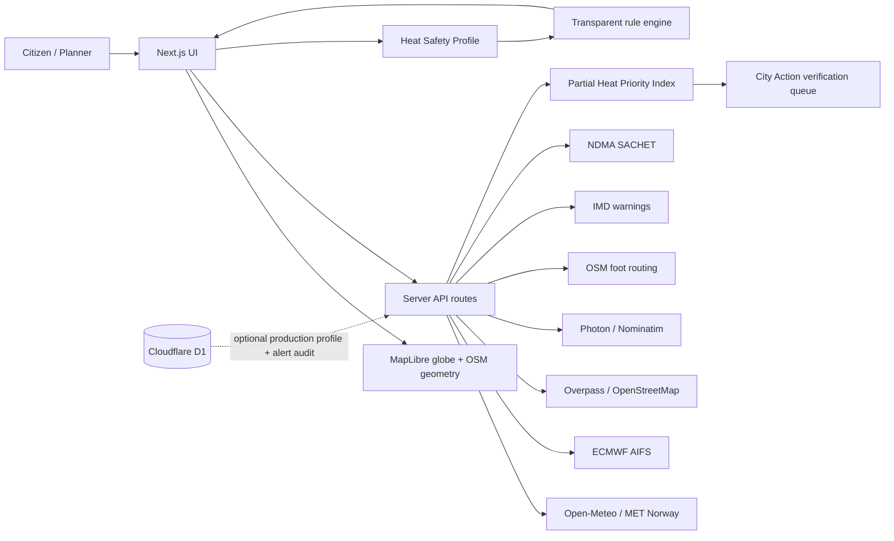

# TERRA07 — Heat-Risk Mapping at Human Scale

## Executive summary
TERRA07 turns a city-scale heat forecast into a street-aware, explainable action interface for citizens and city planners. Real OpenStreetMap road geometry is coloured using live weather-model estimates, while an optional Heat Safety Profile can move preventive guidance earlier without weakening official warnings.

## What the rebuilt system includes
- Immersive MapLibre globe, terrain, hillshade and optional local 3D building extrusions.
- Live weather with primary/fallback providers and explicit stale/unavailable handling.
- Real OSM roads down to residential/service/pedestrian/footway/path classes at close zoom.
- Search suggestions plus independent full Search submission.
- Live location, current-street identification, forecast timeline and source-age display.
- Heat Safety Profile and conservative, transparent earlier-guidance rules.
- Fixed/versioned health content and emergency flow; no generative clinical advice.
- Real walking alternatives from a dedicated OSM foot-routing service.
- Planner map, hottest named-road verification queue and partial evidence index.
- IMD and NDMA alert adapters.
- PWA service worker and Capacitor Android/iOS shell configuration.

## Architecture

## Scientific honesty
Street shapes are actual mapped road geometry. Weather is live/provider data. A coloured street value is an interpolation/estimate, not a thermometer measurement on that street. Zooming can reveal more road geometry but does not increase the underlying regional weather-model resolution. Missing risk factors remain visibly unconnected rather than being fabricated.

## Risk model status
The planner currently exposes a **Partial Heat Priority Index**, not a validated full human-health risk score. Connected factors can include apparent heat, model surface temperature, mapped building footprint ratio and mapped green-space deficit. Population vulnerability, verified shade, impervious surface classification and calibrated local-sensor evidence remain separate completion gates.

## Validation boundary
Source/static QA and TypeScript syntax parsing are included in the repository. A production claim requires dependency installation, full Next.js build, browser/device QA, provider reachability tests, D1 migration validation, accessibility testing, medical review and calibration against trusted observations/sensors.
